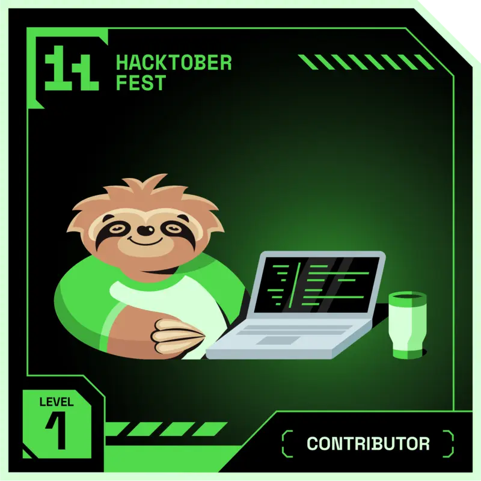
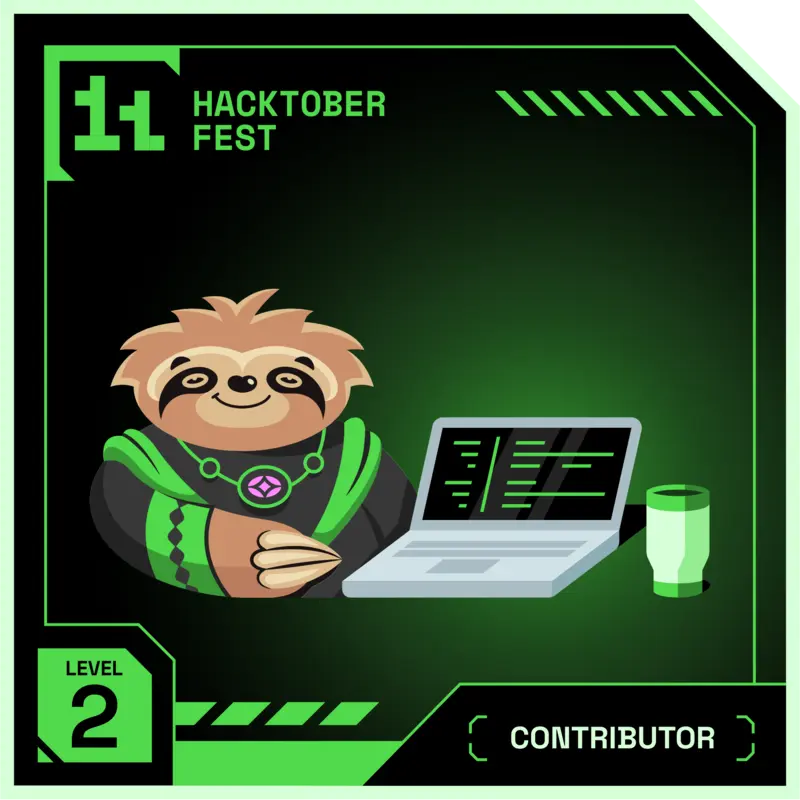
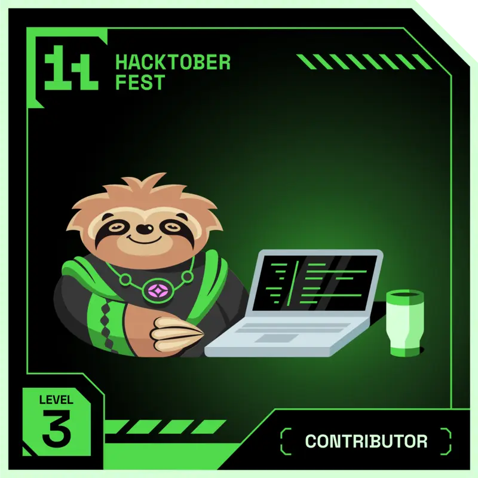

<a href="https://byhemant.tech">
  
</a>

### DESCRIPTION

I'm a CS undergrad at Newton School of Technology (2024–2028), based in Pune. I work across the whole stack, from the Raspberry Pi inside a robot to the web app on top of it.

Two ideas keep pulling me back. The first is **AI that runs on your own machine**, with no cloud bill and no data leaving the laptop. The second is **agents that do real work on someone's behalf**.

Open to internships and collaborations. [`mail(1)`](mailto:9610hemant@gmail.com) is the fastest way to reach me.

### COMMANDS

<dl>
  <dt><code>hemant proxy</code> &nbsp;<a href="https://proxy-dating.vercel.app">live</a> · <a href="https://github.com/hk2166/proxy-dating">src</a></dt>
  <dd>Agents that date for you. Paste a LinkedIn and a public Instagram: an agent reads both, writes the profile, dates every other agent on that person's behalf, and ranks who fits best.<br><sub>TypeScript · Next.js · Upstash Redis · Apify</sub></dd>

  <dt><code>hemant confab</code> &nbsp;<a href="https://github.com/hk2166/Transcriber/releases/latest">download for macOS</a> · <a href="https://github.com/hk2166/Transcriber">src</a></dt>
  <dd>Private meeting notes for macOS. Transcribes live on-device, summarizes with a local LLM, and lets you search and chat across every meeting you've had. No bot joins the call and no audio leaves the laptop.<br><sub>Python · Rust · faster-whisper · Ollama</sub></dd>

  <dt><code>hemant voiceforge</code> &nbsp;<a href="https://github.com/hk2166/Modulizer">src</a></dt>
  <dd>Voice cloning with no cloud and no subscription. Record yourself, type some text, and hear it back in your own voice, about 30 seconds after you start, on a plain CPU.<br><sub>Python · XTTS v2 · PyTorch · FastAPI · Tauri</sub></dd>

  <dt><code>hemant campus-bot</code> &nbsp;<a href="https://github.com/hk2166/turtle_bot">src</a></dt>
  <dd>Mapping and navigation for an office delivery robot, with lidar, on a Raspberry Pi 5.<br><sub>ROS 2 Jazzy · Python · C++</sub></dd>

  <dt><code>hemant voice-rag</code> &nbsp;<a href="https://rag-agenticvoice-1.onrender.com/">live</a> · <a href="https://github.com/hk2166/RAG_AgenticVoice">src</a></dt>
  <dd>Ask a PDF a question out loud and hear the answer. Speech goes to text, FAISS pulls the relevant passages, Claude writes an answer grounded in them, and Edge-TTS reads it back.<br><sub>FastAPI · FAISS · Claude · Gemini · Edge-TTS</sub></dd>

  <dt><code>hemant gridwars</code> &nbsp;<a href="https://grid-for-me.vercel.app">live</a> · <a href="https://github.com/hk2166/GridForME">src</a></dt>
  <dd>Real-time multiplayer territory capture. Claim tiles on a shared grid and steal them from other players; every move reaches every player the moment it happens.<br><sub>TypeScript</sub></dd>

  <dt><code>hemant news</code> &nbsp;<a href="https://ai-news-aggregator-grhq.onrender.com/">live</a> · <a href="https://github.com/hk2166/ai_news_aggregator">src</a></dt>
  <dd>Scrapes AI news every 6 hours, has Gemini summarize and tag each article, and serves full-text search from Postgres.<br><sub>Python · Gemini · PostgreSQL</sub></dd>

  <dt><code>hemant mario</code> &nbsp;<a href="https://github.com/hk2166/MarioByGesture">src</a></dt>
  <dd>Play browser platformers with your hands. The webcam tracks your hand and turns gestures into game controls.<br><sub>Python · MediaPipe · OpenCV</sub></dd>
</dl>

### STATUS

Live from my public repos. Each repo is a process, and %CPU is its share of my commits over the last 30 days. A workflow in this repo redraws it every 6 hours.


### ENVIRONMENT

```
LANG      TypeScript  Python  JavaScript
WEB       React  Next.js  Tailwind  Node  Express  FastAPI
AI        PyTorch  TensorFlow  OpenCV  MediaPipe  FAISS  Ollama  Pandas  NumPy
ROBOTS    ROS 2  Raspberry Pi  Linux
DATA      PostgreSQL  MongoDB  Supabase  Prisma
SHIP      Vercel  Render  Netlify  Git
```

### HISTORY

Hacktoberfest Super Contributor in 2024 and in 2025.

<p>
  
  
  
  
  
  <br>
  
  
  
  
  
  
  
</p>

### BUGS

Starts a new repo whenever an idea gets loud enough. Has fixed a production bug at 2 AM on cold coffee and willpower, and will do it again.

### SEE ALSO

[`byhemant.tech(1)`](https://byhemant.tech), [`linkedin(1)`](https://www.linkedin.com/in/hemant9610/), [`mail(1)`](mailto:9610hemant@gmail.com), [`sparse(7)`](https://sparse-one.vercel.app)

```
github.com/hk2166               since May 2023                    HEMANT(1)
```
